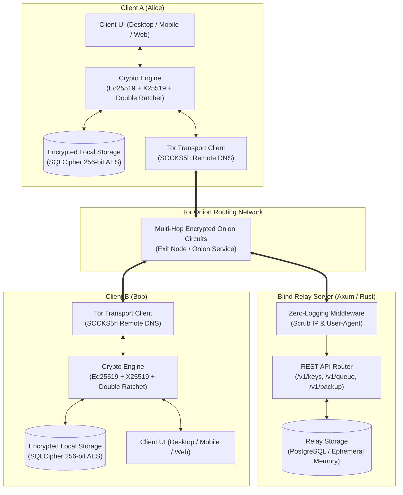
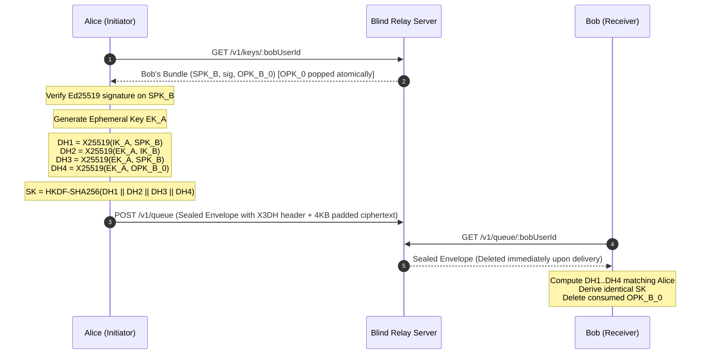
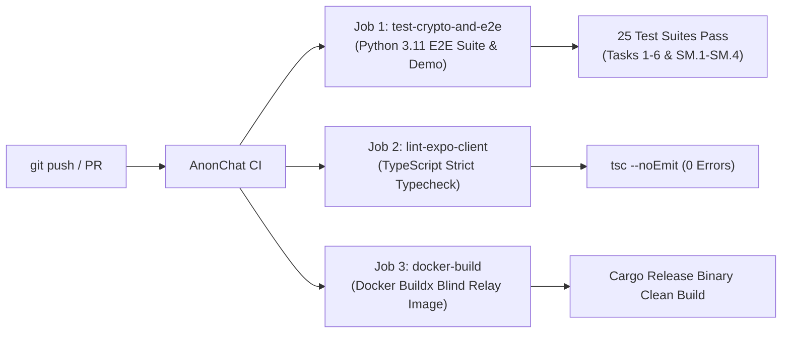

# AnonChat — System Architecture & Protocol Specification

## 1. Executive Overview & Design Philosophy

AnonChat is an open-source, multiplatform, zero-knowledge anonymous messaging ecosystem engineered to provide maximum operational security, forward secrecy, post-compromise security, metadata blindness, and side-channel resistance.

Unlike conventional secure messengers that mandate telephone numbers, email addresses, or persistent identity registries, AnonChat decouples user identity from all real-world identifiers:
- **No Telephone Numbers or Email Addresses**: User identity is represented purely as an **Ed25519 public key fingerprint** formatted as a hexadecimal "Friend Code" (`anon:fc:<hex>`).
- **Complete Transport Anonymity**: Network transport is isolated through the Tor network via SOCKS5 proxy (`socks5h://127.0.0.1:9050` with remote DNS resolution) to eliminate IP address and location metadata leaks.
- **Zero-Knowledge Blind Relay**: The central relay server operates under strict zero-logging semantics. It acts as an oblivious store-and-forward mailbox that routes encrypted payloads without ever observing sender identities, message plaintext, cryptographic keys, or user social graphs.
- **Side-Channel Hardened Backups**: Offline encrypted backups use self-describing 42-byte binary headers, Argon2id key derivation with 256-bit high-entropy recovery codes (BIP39 24 words or Crockford Base32 52 characters), and post-encryption fixed-block padding (64 KiB) to defeat size-based content inferencing.

---

## 2. High-Level System Architecture



---

## 3. Cryptographic Protocol Stack

### 3.1 Cryptographic Identity & PreKey Bundles
Every client maintains an asynchronous cryptographic identity generated entirely locally:
1. **Identity KeyPair ($IK$)**: Ed25519 keypair for digital signatures and long-term authentication.
2. **Identity DH KeyPair**: X25519 keypair derived or associated with the identity for Diffie-Hellman operations.
3. **Signed PreKey ($SPK$)**: Medium-term X25519 keypair signed by the Ed25519 identity key (`Ed25519Sign(IK_{priv}, SPK_{pub})`), rotated periodically.
4. **One-Time PreKeys ($OPK_0 \dots OPK_{99}$)**: Pool of 100 ephemeral X25519 keypairs uploaded to the relay server to guarantee forward secrecy during initial contact.

The public bundle published to `POST /v1/keys` consists of:
$$\text{PreKeyBundle} = \{ \text{userId}, IK_{pub}, IK_{dh}, SPK_{id}, SPK_{pub}, SPK_{sig}, [OPK_0, OPK_1, \dots] \}$$

### 3.2 Extended Triple Diffie-Hellman (X3DH) Key Agreement
To initiate a secure session with Bob, Alice fetches Bob's bundle via `GET /v1/keys/:bobUserId`. The relay atomically pops one OPK:



### 3.3 Double Ratchet Continuous Rekeying & AEAD
Once initialized from the X3DH shared secret $SK$:
- **Root Key Ratchet ($KDF\_RK$)**: Advances on every Diffie-Hellman ratchet turnaround using HKDF-SHA256 with info parameter strictly set to `"DoubleRatchet"`.
- **Symmetric Sending/Receiving Chains ($KDF\_CK$)**: Advances per message using HMAC-SHA256 with constants `0x01` (input key) and `0x02` (chain key), yielding a fresh AES-256-GCM key for each transmission.
- **Wire Header Authentication (AAD)**: Canonical wire header `{"dh": "...", "pn": uint32, "n": uint32}` is authenticated as AAD into AES-256-GCM.
- **Out-of-Order Message Handling**: Skipped message keys are cached indexed by $(DH_r, N)$ with an upper limit (`MAX_SKIP = 1000`) preventing memory exhaustion attacks.
- **Message Key Zeroization**: Derived message keys ($MK$) are securely wiped from RAM immediately following encryption or decryption (`zeroize::ZeroizeOnDrop`).

### 3.4 Three-Phase Durable Persistence Pipeline
To guard against nonce and key reuse across app restarts or crashes, every state transition enforces a three-phase commit:

```
[Phase 1: Derivation & Cryptographic Operation]
   ├── Encrypt: (header, ciphertext) = encrypt(state, plaintext)
   └── Decrypt: plaintext = decrypt(state, header, ciphertext)
                   │
                   ▼
[Phase 2: Durable State Persistence (Barrier)]
   ├── Serialize complete RatchetState
   ├── Write to SQLite / SQLCipher with PRAGMA synchronous = FULL & journal_mode = WAL
   └── Wait for physical fsync confirmation
                   │
                   ▼
[Phase 3: Release to Outside World]
   ├── Encrypt Path: Release ciphertext to Tor network dispatch
   └── Decrypt Path: Release decrypted plaintext to UI timeline
```

---

## 4. Multi-Platform Implementation Matrix

AnonChat maintains native client implementations across five software ecosystems sharing a unified cryptographic architecture:

| Platform | Language & UI | Cryptography Engine | Local Encrypted Storage | Network / Tor |
| :--- | :--- | :--- | :--- | :--- |
| **Rust Desktop** | Rust 2021 + `egui` / `eframe` | `anonchat-crypto` (dalek, aes-gcm, argon2) | SQLCipher 256-bit (`rusqlite`) | `arti-client` / SOCKS5h proxy |
| **Android** | Kotlin + Jetpack Compose | Libsignal / BouncyCastle / Dalek bindings | SQLCipher for Android (`androidx.sqlite`) | SOCKS5h Tor / Orbot integration |
| **iOS** | Swift + SwiftUI | Apple CryptoKit + Libsignal C bindings | Apple Keychain + SQLite SQLCipher | SOCKS5h Tor / OnionBrowser daemon |
| **React Native** | TypeScript + Expo | `@toled/signal-expo` + `@sonnetstationsolutions/expo-argon2` | `expo-secure-store` | SOCKS5h client abstraction |
| **Flutter** | Dart + Flutter UI | `package:cryptography` (Argon2id, AES-GCM) | `flutter_secure_storage` | SOCKS5h HTTP transport |
| **Web WASM** | TypeScript + React | `@getmaapp/signal-wasm` + WebCrypto API | Encrypted IndexedDB (`idb`) | Fetch via Tor bridge / WebSocket proxy |

---

## 5. Blind Relay Server Architecture

The server (`crates/anonchat-server`) is designed under the principle of **hostile infrastructure**: even a compromised server or lawful interception order yields zero readable data or social graph intelligence.

### 5.1 Endpoints Specification

| Method & Route | Purpose | Payload Constraints | Anonymity Invariant |
| :--- | :--- | :--- | :--- |
| `POST /v1/keys` | Publish/Update PreKeyBundle | JSON bundle with Ed25519 signature | Indexed solely by `userId` (hash of public key). |
| `GET /v1/keys/:userId` | Fetch bundle for session init | None | **Atomic OPK Pop**: Returns one OPK and deletes it instantly. |
| `POST /v1/queue` | Enqueue sealed encrypted blob | `{ "recipientId": "...", "blob": "<bytes>" }` | **Sealed Sender**: Server has zero visibility into who sent the blob. |
| `GET /v1/queue/:userId` | Drain pending inbox | None | **Instant Purge**: Deleted from DB upon delivery (`DELETE ... RETURNING`). |
| `POST /v1/backup` | Upload encrypted backup blob | Opaque binary blob up to 100 MB | Overwrites previous backup on conflict (`ON CONFLICT REPLACE`). |
| `GET /v1/backup/:userId` | Download backup container | None | Served as an opaque byte stream. |

### 5.2 Zero-Logging Middleware
A custom Axum/Tower middleware strips all HTTP transport telemetry:
- Strips `User-Agent`, `Referer`, `X-Forwarded-For`, and `X-Real-IP`.
- Omits client IP and port from tracing subscribers and access logs.
- Enforces payload bounds (`DefaultBodyLimit = 100 MB`).

---

## 6. Backup Subsystem & Side-Channel Resistance

To prevent attacks similar to WhatsApp and Signal backup side-channel exploits (where deduplication, compression, and variable sizes allowed plaintext inference), AnonChat implements a hardened backup pipeline:

### 6.1 Binary Header Layout (42 Bytes)

```
0                   1                   2                   3
0 1 2 3 4 5 6 7 8 9 0 1 2 3 4 5 6 7 8 9 0 1 2 3 4 5 6 7 8 9 0 1
+-+-+-+-+-+-+-+-+-+-+-+-+-+-+-+-+-+-+-+-+-+-+-+-+-+-+-+-+-+-+-+-+
|       Magic: 'A' 'N' 'O' 'N' (0x41 0x4E 0x4F 0x4E)            |
+-+-+-+-+-+-+-+-+-+-+-+-+-+-+-+-+-+-+-+-+-+-+-+-+-+-+-+-+-+-+-+-+
|  Ver (0x01)   |  KDF (0x01)   | TimeCost (u8) | MemExp (u8)   |
+-+-+-+-+-+-+-+-+-+-+-+-+-+-+-+-+-+-+-+-+-+-+-+-+-+-+-+-+-+-+-+-+
| Parallel (u8) |                Salt (16 bytes)                |
+-+-+-+-+-+-+-+-+                                               +
|                                                               |
+                                                               +
|                                                               |
+                               +-+-+-+-+-+-+-+-+-+-+-+-+-+-+-+-+
|                               | Cipher (0x01) |               |
+-+-+-+-+-+-+-+-+-+-+-+-+-+-+-+-+-+-+-+-+-+-+-+-+               +
|                       Nonce (12 bytes)                        |
+                                                               +
|                                                               |
+-+-+-+-+-+-+-+-+-+-+-+-+-+-+-+-+-+-+-+-+-+-+-+-+-+-+-+-+-+-+-+-+
|                    Ciphertext Length (u32 LE)                 |
+-+-+-+-+-+-+-+-+-+-+-+-+-+-+-+-+-+-+-+-+-+-+-+-+-+-+-+-+-+-+-+-+
|                  AES-256-GCM Ciphertext + 16B Tag             |
|                               ...                             |
+-+-+-+-+-+-+-+-+-+-+-+-+-+-+-+-+-+-+-+-+-+-+-+-+-+-+-+-+-+-+-+-+
|                  Trailing Zero Padding (to 64 KiB)            |
|                               ...                             |
+-+-+-+-+-+-+-+-+-+-+-+-+-+-+-+-+-+-+-+-+-+-+-+-+-+-+-+-+-+-+-+-+
```

### 6.2 High-Entropy Recovery Codes
To eliminate weak or reused passphrases, backups support 256-bit cryptographically generated recovery codes:
- **Option B (Recommended)**: 24 words from the BIP39 English dictionary (256 bits entropy + 8-bit SHA-256 checksum).
- **Option A**: 52-character Crockford Base32 string organized into 13 groups of 4 separated by spaces (excluding ambiguous `0/O`, `1/I/L`).
- **Key Derivation Formula**:
  $$\text{Key} = \text{Argon2id}(\text{recoveryCode}, \text{salt}, \text{memory}=64\,\text{MB}, \text{iterations}=3, \text{parallelism}=4, \text{key\_len}=32)$$

### 6.3 Side-Channel Elimination Invariants
- **No Compression Before Encryption**: Disallows zlib, gzip, or brotli compression on plaintext.
- **No Deduplication**: Identical messages or attachments are never shared across blocks or backups.
- **Post-Encryption Fixed-Block Padding**: Padded to fixed 64 KiB blocks ($65,536 \times k$). Even exact block multiples receive full block padding.
- **Constant-Time Verification**: Corrupted padding bytes trigger identical uniform authentication failure errors.

---

## 7. Safety Numbers & Key-Change Protocol Lockdown

To protect against active Man-In-The-Middle (MITM) attacks and malicious relay compromises:
1. **60-Digit Safety Number**:
   - Deterministically derived from both parties' public identity keys ($IK_A, IK_B$).
   - Keys are sorted lexicographically, concatenated, and hashed through **5,200 iterations of SHA-512**.
   - Formatted into 12 blocks of 5 decimal digits for visual or out-of-band QR code verification.
2. **Key-Change Detection**:
   - If a peer's identity key changes, the client resets `verifiedAt = null`.
   - Inserts a persistent, non-dismissable security warning directly into the conversation timeline.
   - Disables the message input field and halts all outbound transmissions until the user completes re-verification or explicitly accepts the updated key.

---

## 8. Verification & Continuous Integration Pipeline

AnonChat enforces strict automated quality and security checks via GitHub Actions:



To run verification locally:
```bash
# 1. Run full cryptographic verification suite (25 test suites)
python tests/e2e_verification.py

# 2. Run interactive chat demonstration
python scripts/demo_chat.py

# 3. Typecheck React Native / Expo client
cd expo-client && npx tsc --noEmit

# 4. Build blind relay container
docker compose build
```
