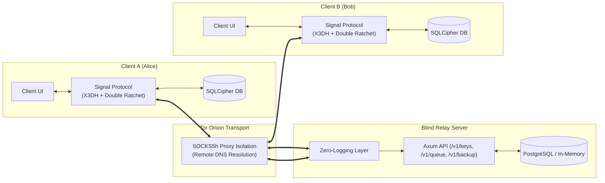

# AnonChat — Anonymous End-to-End Encrypted Messenger

[](https://github.com/istiakahasan/AnonChat---Anonymous-E2EE-Messenger/actions/workflows/ci.yml)
[](LICENSE)
[](https://www.torproject.org/)
[](docs/SECURITY_SPECIFICATION.md)

AnonChat is an open-source, zero-knowledge, anonymous messaging application designed with forward secrecy, post-compromise security, metadata protection, transport-level anonymity, and side-channel resistance.

---

## 📑 Table of Contents

- [Core Principles & Security Invariants](#-core-principles--security-invariants)
- [System Architecture](#-system-architecture)
- [Repository Layout](#-repository-layout)
- [Implemented Cryptographic Tasks](#-implemented-cryptographic-tasks)
  - [Task 1: Cryptographic Identity Layer](#task-1-cryptographic-identity-layer-client-side)
  - [Task 2: X3DH Key Agreement](#task-2-x3dh-key-agreement-client-side)
  - [Task 3: Double Ratchet State Machine](#task-3-double-ratchet-state-machine-client-side)
  - [Task 4: Zero-Knowledge Blind Relay Server](#task-4-blind-relay-server-server-side)
  - [Task 5: Tor SOCKS5 Transport & Circuit Resilience](#task-5-tor-integration-client-side)
  - [Task 6: Multiplatform User Interface](#task-6-ui-skeleton--clients)
  - [Task 7: Safety Numbers & Key-Change Lockdown](#task-7-safety-numbers--identity-key-change-lockdown)
  - [Task 8: Self-Describing Backup Container Format](#task-8-self-describing-backup-container-format)
  - [Sub-Step 6: Backup Side-Channel Hardening](#sub-step-6-backup-side-channel-hardening)
  - [Security Modules SM.1 – SM.4: Protocol Hardening](#security-modules-sm1--sm4-protocol-hardening)
- [Multi-Platform Clients Matrix](#-multi-platform-clients-matrix)
- [Verification & CI Testing](#-verification--ci-testing)
- [Getting Started & Local Development](#-getting-started--local-development)
- [Security Requirements Checklist](#-security-requirements-checklist)

---

## 🛡️ Core Principles & Security Invariants

1. **End-to-End Encryption (E2EE)**: Implements the Signal Protocol (**X3DH** for mutual authentication and asynchronous key agreement + **Double Ratchet** for continuous symmetric and Diffie-Hellman ratcheting).
2. **Complete Anonymity**: No phone numbers, no email addresses, no accounts, no central directory. User identity is an **Ed25519 public key fingerprint** ("Friend Code").
3. **Transport Privacy via Tor**: Traffic is routed through Tor using SOCKS5 proxy isolation (`socks5h://127.0.0.1:9050` with remote DNS resolution) to eliminate IP and DNS leaks.
4. **Zero-Knowledge Blind Relay**: The relay server never sees message plaintext, encryption keys, or the social graph. Sealed Sender envelopes hide sender identities from the server.
5. **Traffic Analysis Defense**: All encrypted payloads are padded to fixed-size blocks (4096 bytes / 4KB) with cryptographically secure random bytes prior to transmission.
6. **Encrypted Storage & Disappearing Messages**: Local SQLite database is encrypted with SQLCipher (256-bit AES), and messages past their Time-To-Live (TTL) are automatically purged by a background engine.
7. **Side-Channel Hardened Backups**: Post-encryption fixed-block padding (64 KiB), strict prohibition of compression and deduplication, and 256-bit high-entropy recovery codes (BIP39 24 words / Crockford Base32 52 characters) protect against size inferencing.
8. **Persist-Before-Release Barrier**: The Double Ratchet state is durably persisted to disk (with full fsync / ACID commit) before any ciphertext is dispatched to the network or any plaintext is delivered to the UI.

---

## 🏗️ System Architecture

For detailed architectural diagrams, sequence flows, and subsystem specifications, refer to [ARCHITECTURE.md](ARCHITECTURE.md).



---

## 📂 Repository Layout

```
Anon_Chat/
├── Cargo.toml                      # Cargo workspace root (Rust crates)
├── README.md                       # Main project documentation & quickstart
├── ARCHITECTURE.md                 # In-depth architectural & protocol specification
├── docker-compose.yml              # Blind relay server & PostgreSQL orchestration
├── docs/
│   └── SECURITY_SPECIFICATION.md   # Cryptographic threat model & protocol spec (50+ KB)
├── crates/
│   ├── anonchat-crypto/            # Core cryptographic library (X3DH, Double Ratchet, Backups)
│   ├── anonchat-server/            # Blind Relay microservice (Axum + SQLx + Zero-logging)
│   ├── anonchat-client/            # Core client library (Tor SOCKS5, SQLCipher, Session Manager)
│   └── anonchat-ui/                # Native Desktop client (Rust + egui / eframe)
├── expo-client/                    # React Native / Expo client (@toled/signal-expo + Argon2)
├── flutter_client/                 # Flutter / Dart client (package:cryptography + libsignal)
├── android/                        # Android Native client (Kotlin + Jetpack Compose + SQLCipher)
├── ios/                            # iOS Native client (Swift + SwiftUI + CryptoKit)
├── web-client/                     # Browser WASM client (@getmaapp/signal-wasm + WebCrypto)
├── scripts/
│   └── demo_chat.py                # Interactive Alice & Bob demonstration harness
└── tests/
    └── e2e_verification.py         # Automated End-to-End verification test suite (25 test suites)
```

---

## 🔐 Implemented Cryptographic Tasks

### Task 1: Cryptographic Identity Layer (Client-Side)
- **Identity KeyPair**: Locally generated Ed25519 keypair for signatures and long-term authentication.
- **PreKeys**:
  - 1 Signed PreKey ($SPK$) signed by the Ed25519 Identity Key.
  - 100 One-Time PreKeys ($OPK_0 \dots OPK_{99}$) with sequential IDs.
- **Secure Memory**: Secret keys wrapped in `secrecy::Secret` and `zeroize::ZeroizeOnDrop` to prevent RAM exposure and console leaks.
- **Friend Code**: Hexadecimal fingerprint representation of the public identity key (`anon:fc:<hex>`).

### Task 2: X3DH Key Agreement (Client-Side)
- Alice fetches Bob's public `PreKeyBundle` from the relay.
- Alice verifies Bob's Ed25519 signature on the Signed PreKey.
- Generates ephemeral X25519 keypair $EK_A$.
- Derives 256-bit Shared Secret via HKDF-SHA256 from 4 Diffie-Hellman outputs:
  $$\text{SharedSecret} = \text{HKDF-SHA256}(DH_1 \parallel DH_2 \parallel DH_3 \parallel DH_4)$$
- Bob computes the identical secret upon receiving Alice's initiation envelope and deletes the consumed OPK.

### Task 3: Double Ratchet State Machine (Client-Side)
- **Symmetric KDF Chains**: Advances per-message sending and receiving chains with HMAC-SHA256.
- **DH Ratchet Turnaround**: Re-keys root key via HKDF-SHA256 whenever a new peer DH key arrives.
- **4KB Fixed-Block Padding**: Plaintext is padded with CSPRNG bytes to a multiple of 4096 bytes before AES-256-GCM.
- **Out-of-Order Delivery**: Skipped message keys are cached up to `MAX_SKIP = 1000` to prevent memory exhaustion DoS.

### Task 4: Blind Relay Server (Server-Side)
- Built with **Rust / Axum**:
  - `POST /v1/keys`: Stores `PreKeyBundle` keyed by `userId`.
  - `GET /v1/keys/:userId`: Returns bundle with **atomic OPK popping** (`DELETE ... RETURNING`).
  - `POST /v1/queue`: Accepts `{ recipientId, blob }` with zero sender metadata (Sealed Sender).
  - `GET /v1/queue/:userId`: Drains messages and **purges them immediately** upon delivery.
  - `POST /v1/backup` & `GET /v1/backup/:userId`: Stores and retrieves opaque backup containers up to 100 MB.
- **Zero-Logging Middleware**: Tower middleware scrubs IP addresses, `User-Agent`, and forwarding headers.

### Task 5: Tor Integration (Client-Side)
- All network traffic is tunneled through Tor SOCKS5 proxy (`socks5h://127.0.0.1:9050`).
- The `socks5h://` protocol forces remote DNS resolution, preventing ISP DNS query leakage.
- Circuit resilience: Implements exponential backoff with randomized jitter across 5 retries.

### Task 6: UI Skeleton & Clients
- **Desktop (Rust + egui)**: Friend Code QR onboarding, contact timeline, and disappearing messages TTL dropdown.
- **Mobile (React Native / Expo, Flutter, Android, iOS)**: Multi-platform native clients implementing identical security semantics.

### Task 7: Safety Numbers & Identity Key-Change Lockdown
- **60-Digit Safety Number**: Deterministically derived from both parties' public identity keys using **5,200 iterations of SHA-512**, displayed in 12 groups of 5 decimal digits.
- **Key-Change Lockdown**: If a peer's identity key changes:
  1. `verifiedAt` is reset to `null`.
  2. A persistent, non-dismissable security alert is injected into the chat timeline.
  3. Message input field is disabled and outbound transmissions are blocked until re-verification or explicit acknowledgment.

### Task 8: Self-Describing Backup Container Format
- **42-Byte Binary Header**: `Magic ("ANON") || Version (1) || KDF (Argon2id) || TimeCost || MemExp || Parallelism || Salt (16B) || Cipher (AES-256-GCM) || Nonce (12B) || Length (u32 LE)`.
- **Resource Exhaustion Defense**: Bounds parameters before derivation (`memory_exponent <= 20`, `time_cost <= 10`, `parallelism <= 4`).
- **AAD Binding**: 38-byte header authenticated into AES-256-GCM.

### Sub-Step 6: Backup Side-Channel Hardening
- **Fixed-Block Padding**: Post-encryption padding to 64 KiB blocks ($65,536 \times k$), ensuring 1-byte and 1000-byte plaintexts produce identical ciphertext file sizes.
- **Forbidden Features Enforced**:
  - ❌ No compression before encryption (prevents CRIME/BREACH-style size leakage).
  - ❌ No deduplication (prevents cross-backup block sharing).
  - ❌ No incremental backups (every backup is an independent full snapshot).
- **High-Entropy Recovery Codes**: 24-word BIP39 mnemonic phrases or 52-character Crockford Base32 strings.
- **Mandatory Warning Screen**: Explicit warning UI with required checkbox acknowledging that backups are irrecoverable without the recovery code.

### Security Modules SM.1 – SM.4: Protocol Hardening
- **SM.1 (Continuous DH Rekeying)**: Automatic ratchet step triggered whenever `header.dh != state.DHr`.
- **SM.2 (Key Uniqueness & Zeroization)**: Strict derivation of unique message keys with instant in-memory zeroization.
- **SM.3 (State Persistence Durability)**: Persist-before-release barrier with `PRAGMA synchronous = FULL` and `PRAGMA journal_mode = WAL`.
- **SM.4 ("Do Not Invent Your Own Protocol")**: Strictly standardized HKDF info string (`"DoubleRatchet"`), canonical wire format (`{"dh", "pn", "n"}`), 96-bit CSPRNG nonces, and Signal 5,200 SHA-512 Safety Numbers.

---

## 📱 Multi-Platform Clients Matrix

| Platform | Location | Stack & Language | Encryption & Engine | Secure Storage |
| :--- | :--- | :--- | :--- | :--- |
| **Desktop UI** | `crates/anonchat-ui/` | Rust 2021 + `egui` / `eframe` | `anonchat-crypto` | SQLCipher 256-bit |
| **Expo / React Native** | `expo-client/` | TypeScript + React Native 0.74 | `@toled/signal-expo` + Argon2 | `expo-secure-store` |
| **Flutter** | `flutter_client/` | Dart + Flutter 3 | `package:cryptography` | `flutter_secure_storage` |
| **Android Native** | `android/` | Kotlin + Jetpack Compose | Libsignal / Dalek bindings | SQLCipher for Android |
| **iOS Native** | `ios/` | Swift 5.9 + SwiftUI | Apple CryptoKit + Libsignal C | Apple Keychain + SQLCipher |
| **Web Browser** | `web-client/` | TypeScript + React 18 | `@getmaapp/signal-wasm` + WebCrypto | Encrypted IndexedDB |

---

## 🧪 Verification & CI Testing

AnonChat includes an automated test harness covering all protocol invariants, side-channel defenses, and durability pipelines:

### 1. Run Cryptographic & E2E Verification Suite (25 Test Suites)
```bash
python tests/e2e_verification.py
```

### 2. Run Interactive Chat Demo
```bash
python scripts/demo_chat.py
```

### 3. Typecheck Expo / React Native Client
```bash
cd expo-client
npm install --legacy-peer-deps
npx tsc --noEmit
```

### 4. Build Blind Relay Container
```bash
docker compose build
```

---

## 🚀 Getting Started & Local Development

### Prerequisites
- **Python 3.10+** (for verification harness and test suites)
- **Rust 1.80+** & Cargo (for desktop UI and blind relay server)
- **Node.js 20+** & npm (for Expo client and Web client)
- **Docker & Docker Compose** (for containerized relay and database)
- **Tor Daemon** (listening on `127.0.0.1:9050` or Orbot on `9150`)

### Running the Blind Relay Server locally

Using Docker Compose:
```bash
docker compose up -d
```

Or running directly with Cargo (using Ephemeral In-Memory Storage):
```bash
cargo run --package anonchat-server
```

### Running the Desktop UI
```bash
cargo run --package anonchat-ui
```

### Running the Expo Client
```bash
cd expo-client
npm install --legacy-peer-deps
npx expo start
```

---

## ✅ Security Requirements Checklist

- [x] **No plaintext is ever written to disk without encryption**: Encrypted via SQLCipher (256-bit AES) with keys derived from hardware-backed keystores.
- [x] **Keys are never logged to console**: Memory wrapped in `secrecy::Secret` and `zeroize::ZeroizeOnDrop` with redacted debug formatters.
- [x] **The server never sees the sender's identity**: Enforced by Sealed Sender envelopes (relay only sees recipient ID and opaque ciphertext).
- [x] **Messages are padded to a fixed length (4KB) before encryption**: Implemented in `cipher::pad_message` with CSPRNG bytes to defeat traffic analysis.
- [x] **State is durably persisted before ciphertext release**: Three-phase commit barrier with `PRAGMA synchronous = FULL` eliminates key/nonce reuse.
- [x] **Backups are hardened against size-based side channels**: 64 KiB fixed-block padding, no compression, no deduplication, 256-bit high-entropy recovery codes.
